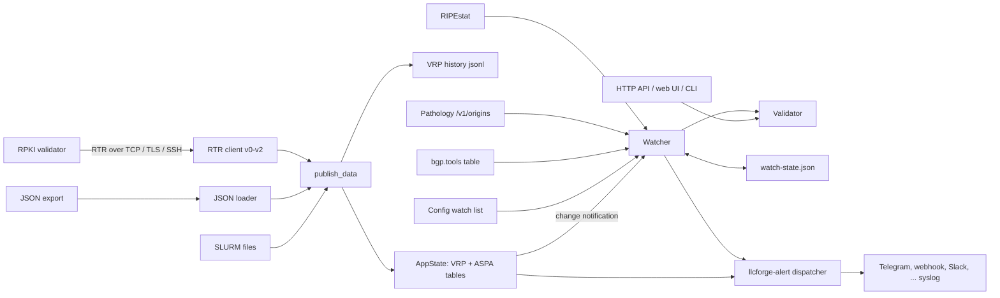

# Notary Architecture

RPKI Route Origin Validation checker. Tells you whether your prefixes are RPKI-valid and watches third-party ASes.

This document describes how Notary is put together, where its trust boundaries are and how it behaves when things go wrong. It is the starting point for contributors; keep it up to date when you change the design.

## Design principles

- **Self-hosted, single binary.** No SaaS dependency, no external database. VRPs live in memory; the small amount of durable state (watch state, VRP history, alert queue, silences) is plain files in the data directory.
- **Fail safe and loud.** Missing or stale input is reported as such; silence is never treated as "all clear". An empty VRP set is refused.
- **Untrusted input everywhere.** RTR PDUs, JSON exports, SLURM files, RIPEstat / Pathology / bgp.tools / RIPE DB / whois responses and API requests are parsed defensively with explicit size limits. No `unsafe`.
- **Secrets from the environment.** Tokens, passwords and keys' passphrases are read from environment variables named in the config, never from config files or logs.
- **Pure Rust crypto on every OS.** rustls + ring for TLS, russh (ring backend, no RSA) for SSH; Linux, macOS and Windows build the same code.
- **Observable.** Prometheus `/metrics` (`notary_*` plus the shared `llcforge_alert_*`), `/healthz`, `/readyz`, text or JSON logs.

## Data flow



## Components

| Component | Source | Responsibility |
|---|---|---|
| **PDU codec** | `src/rtr/pdu.rs` | Encodes/decodes RTR v0, v1 and v2 PDUs. Exact length per fixed-size PDU, bounded Error Report parsing, 64 KiB maximum PDU. ASPA (type 11) decoded on v2 with the 8210bis provider-list rules (non-empty, strictly increasing, no AS0 mixed in, empty on withdraw); skipped on v0/v1. Router Key skipped, unknown types rejected. |
| **Transports** | `src/rtr/transport.rs` | `host:port` (TCP), `tls://` (rustls, Mozilla roots or a CA file, optional client certificate), `ssh://user@host` (russh, `rpki-rtr` subsystem, pinned SHA-256 host key fingerprint, Ed25519/ECDSA key or password). Connects are time-boxed. |
| **RTR client** | `src/rtr/client.rs` | Reset Query on connect, Serial Query on the refresh timer or Serial Notify, Cache Reset handling, version step-down (2 -> 1 -> 0) on Unsupported Version. A reader task frames PDUs and is aborted when the connection is dropped. |
| **JSON loader** | `src/vrp.rs` | `{"roas":[...],"aspas":[...]}` from file or URL (512 MiB cap), ASN as `"AS64500"` or `64500`, rpki-client `expires`, Routinator `jsonext` `chainValidity.notAfter`, ASPA `customer_asid` / `customer`. |
| **SLURM** | `src/slurm.rs` | RFC 8416 prefix filters and assertions (strict schema, 16 MiB per file). Applied in `publish_data`; the last raw set is kept so a reload re-applies new rules immediately. |
| **VRP table** | `src/vrp.rs`, `src/state.rs` | Arena-backed binary tries (IPv4 / IPv6), the sorted VRP list, ASPA map and expiry map, built per update and swapped behind `RwLock<Arc<_>>`. |
| **Validator** | `src/validator.rs` | Pure RFC 6811 function returning state, reason and every covering VRP. |
| **ASPA verifier** | `src/aspa.rs` | Pure implementation of the draft's hop function and up/down-ramp algorithm for upstream and downstream paths. |
| **History** | `src/history.rs` | Sorted-merge diff of consecutive tables, one JSON line per change (`baseline` after start), rotation to `.1` at `max_bytes`, newest-first queries filtered by prefix overlap, ASN and time. |
| **Prefix sources** | `src/sources.rs` | RIPEstat `announced-prefixes`, Pathology `/v1/origins` (10 s timeout, bearer token), bgp.tools `table.jsonl` (streamed, 1 GiB cap, 4 KiB line cap, identifying User-Agent, >= 30 min interval). |
| **Watcher** | `src/watch.rs` | Union of `[[watch]]` and per-source `[[watch_as]]` prefixes; re-validates on every VRP change / refresh; `state_change` and `roa_expiring` alerts; state persisted atomically (temp file + rename) to `watch-state.json`. |
| **Audits** | `src/audit.rs`, `src/irr.rs` | ROA suggestions (maxLength = prefix length), RFC 9319 maxLength looseness, IRR route/route6 vs ROA comparison (RIPE DB REST JSON or RPSL whois). |
| **Alerts** | `crates/llcforge-alert` | Shared schema, dispatcher, ten sinks, persistent queue, silences, health/readiness, reload signal, service integration. Notary builds alerts with `tool = "notary"` and stable ids (`notary:<kind>:<resource>`). |
| **API + UI** | `src/api.rs`, `src/ui/` | axum: `/v1/validity` (GET + batch POST), `/v1/status`, `/v1/history`, `/v1/aspa`, `/metrics`, embedded UI (`include_str!`, no CDN). Merged with the kit's health / silences / reload routers. |
| **Daemon** | `src/daemon.rs` | Wires everything, owns its Tokio runtime (so the Windows service entry can call it), applies reloads. |
| **CLI** | `src/main.rs`, `src/commands.rs` | `check` (single / bulk), `run`, `suggest`, `audit`, `irr`, `aspa`, `diff`, `history`, `bench`, `silence`, `service`. |

## Trust boundaries

- **Validator -> Notary.** Plain TCP RTR is unauthenticated: use it only on a trusted network, otherwise use `tls://` (server certificate verified against the configured roots) or `ssh://` (host key pinned by fingerprint; unknown keys are refused before authentication). Notary trusts the validator's cryptographic work. Malformed PDUs end the session with an Error Report and never panic.
- **Remote data.** JSON exports, SLURM files, RIPEstat, Pathology, bgp.tools, RIPE DB and whois responses are size-bounded and fully parsed before use. Prefix-source failures keep the previous list.
- **API.** Binds `127.0.0.1:8323` by default (warning otherwise). `/v1/*` can require a bearer token (`api.token_env`, compared in constant time over SHA-256 digests). `/metrics`, `/healthz`, `/readyz` and the static UI stay open for probes. Request bodies are capped at 4 MiB and batches at `max_batch`. Responses carry `nosniff`, `no-store`, `X-Frame-Options: DENY`, `Referrer-Policy: no-referrer` and a CSP (`default-src 'none'` for data, `script-src 'self'` for the UI).
- **Web UI.** Same-origin only; all data is written with `textContent`; the optional token stays in page memory.
- **Admin routes.** `/v1/silences` and `POST /v1/reload` exist only when their tokens are configured.
- **Secrets** come from environment variables and are kept out of logs; HTTP errors are logged without the request URL.

## Failure modes

| Situation | Behaviour |
|---|---|
| Validator unreachable | Last VRP set is kept. After the expire interval `/v1/status`, `notary_vrp_stale` and `/readyz` report it, and a `vrp_stale` alert fires once; it resolves on recovery. |
| Cache lacks RTR v2 / v1 | Steps down one version per Unsupported Version error and stays there for the session. |
| Empty VRP set (also after SLURM) | Not applied; `vrp_empty_rejected` alert. |
| Prefix source down | Last known list per (source, AS) is used; `notary_prefix_source_errors_total` increases. |
| Alert sink slow or down | The dispatcher queues on disk and retries with backoff; `llcforge_alert_*` metrics show it. Alerts never block validation. |
| Crash or restart | Watch state is reloaded (no duplicate alerts, transitions during downtime still alert); the alert queue is redelivered; history starts with a `baseline` event. |
| Corrupt state file | Ignored with a warning; the watcher starts fresh. |
| Bad config on reload | Rejected with an error log; the running configuration stays. |

## Runtime model

- Tokio multi-threaded runtime built by the daemon. Separate tasks for the VRP source, the RTR socket reader, the watcher, the staleness checker (every 5 s), the alert dispatcher and the HTTP server.
- Each VRP update builds a new table and swaps it in; the watcher is woken through a `tokio::sync::watch` channel.
- Shutdown on Ctrl+C / SIGTERM / service stop: the HTTP server drains, tasks are stopped, the dispatcher flushes for up to 5 s.

## Repository layout

```
Notary/
├── .github/                   CI (Linux, Windows, macOS), release, dependabot
├── crates/llcforge-alert/     vendored shared alerting crate (sync.py)
├── deploy/                    Helm chart, Grafana dashboard, Prometheus rules
├── packaging/                 systemd, launchd, Windows service, Homebrew, scoop, winget, deb/rpm fragment
├── examples/                  vrps.json, slurm.json, routes.txt fixtures
├── src/
│   ├── main.rs                CLI definition and dispatch
│   ├── commands.rs            one-shot commands
│   ├── daemon.rs              run / service, reload
│   ├── config.rs              TOML config, validation, legacy alert keys
│   ├── prefix.rs              Prefix and ASN types
│   ├── vrp.rs                 VRP / ASPA data, trie, JSON loader
│   ├── validator.rs           RFC 6811 validation
│   ├── aspa.rs                ASPA path verification
│   ├── slurm.rs               RFC 8416
│   ├── history.rs             VRP change log
│   ├── audit.rs               ROA suggestions, RFC 9319 audit
│   ├── irr.rs                 IRR comparison
│   ├── sources.rs             RIPEstat, Pathology, bgp.tools
│   ├── state.rs               shared state, readiness, metrics counters
│   ├── watch.rs               watcher, persistence, expiry warnings
│   ├── api.rs                 HTTP API and metrics
│   ├── ui/                    embedded web UI
│   ├── bench.rs               notary bench
│   ├── http.rs                outbound HTTP with size limits
│   └── rtr/                   pdu.rs, client.rs, transport.rs, e2e tests + test-only keys
├── notary.example.toml        annotated example configuration
├── ARCHITECTURE.md            this file
├── README.md / README.tr.md   documentation
```

Unit tests live next to the code (`#[cfg(test)]`), including an in-process fake RTR cache and end-to-end RTR over TLS and SSH against in-process servers using the test-only keys in `src/rtr/testdata/`.

## Related tools

- [Vigil](https://github.com/LLCForge/Vigil): Real-time origin hijack detection over public RIPE RIS and RouteViews feeds. Flags the moment someone else announces your prefix.
- [Pathology](https://github.com/LLCForge/Pathology): BGP route monitor for your own routers and BMP feeds. Learns the AS paths and origins your prefixes normally use, then alerts on any deviation.
- [Herald](https://github.com/LLCForge/Herald): Certificate Transparency log monitor. Sends a Telegram alert the second a new TLS certificate is issued for your domains.
