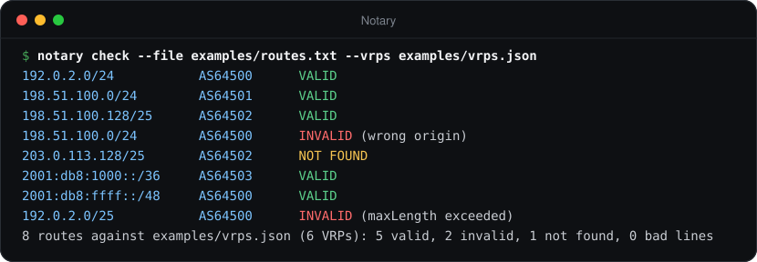
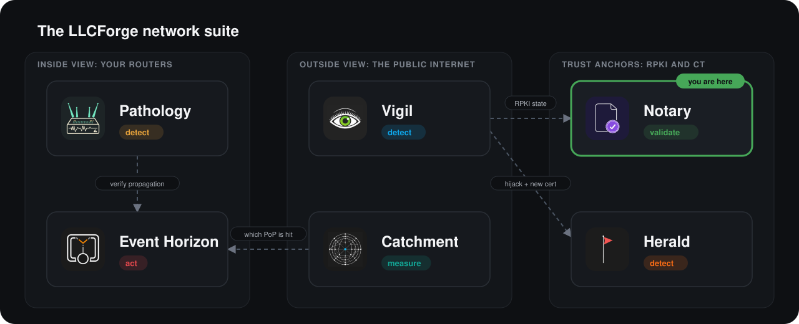

> **LLCForge network tooling** — self-hosted, Rust, no SaaS.
> [Pathology](https://github.com/LLCForge/Pathology) · [Event Horizon](https://github.com/LLCForge/Event-Horizon) · [Catchment](https://github.com/LLCForge/Catchment) · **Notary** · [Herald](https://github.com/LLCForge/Herald) · [Vigil](https://github.com/LLCForge/Vigil)

<!-- readme-visuals -->
<p align="center">
  
</p>

<p align="center">RPKI Route Origin Validation checker. Tells you whether your prefixes are RPKI-valid and watches third-party ASes.</p>

<p align="center">
  <strong>English</strong> · <a href="README.tr.md">Türkçe</a>
</p>

<p align="center">
  <a href="LICENSE"></a>
  
  
</p>

---

## Why

More and more networks drop RPKI-invalid routes. A ROA with the wrong maxLength or a forgotten origin ASN quietly makes your prefix unreachable from half the Internet. Notary keeps a local, always-fresh copy of the validated ROA payloads and answers "is this route valid?" for your prefixes and for any AS you care about, before your customers notice.

## Demo

<p align="center">
  
</p>

<sub>Real output of `notary check --file examples/routes.txt --vrps examples/vrps.json` on sample data that uses documentation address ranges and private ASNs.</sub>

## Features

- **VRP sources:** an RTR client for your own validator (Routinator, rpki-client + StayRTR, FORT) over **plain TCP, TLS (rustls, optional mutual TLS) or SSH** (subsystem `rpki-rtr`, pinned host key), or a JSON export (`{"roas":[...], "aspas":[...]}`) from a file or `http(s)://` URL.
- **RTR client:** versions 0 (RFC 6810), 1 (RFC 8210) and 2 (draft-ietf-sidrops-8210bis, ASPA) with automatic step-down; Reset / Serial Query, incremental updates, Serial Notify, Cache Reset, End of Data timers, Error Reports. Strict per-PDU length checks, 64 KiB PDU cap.
- **Route Origin Validation per RFC 6811:** `Valid`, `Invalid` (`wrong_origin` / `max_length_exceeded`), `NotFound`; every covering VRP is listed and explained. AS0 ROAs never match.
- **ASPA path verification** (draft-ietf-sidrops-aspa-verification, upstream and downstream) with ASPA records from RTR v2 or JSON `aspas`.
- **SLURM** (RFC 8416) local filters and assertions, re-applied on every update and on config reload.
- **ROA expiry warnings** from rpki-client JSON `expires` or Routinator `jsonext` `chainValidity` for every watched route.
- **ROA suggester** (`notary suggest`): minimal ROAs, maxLength = prefix length, for what an AS announces today.
- **maxLength audit** (`notary audit`, RFC 9319): VRPs that authorise prefixes the AS does not announce, with exact replacements.
- **IRR consistency** (`notary irr`): route/route6 objects from the RIPE DB REST API or any IRR whois server compared with ROAs.
- **Validator diff** (`notary diff`): two VRP sources side by side (JSON vs RTR, two caches, ...).
- **Bulk checks** from a file or stdin, text or JSON Lines.
- **VRP change history:** every applied update is diffed and appended to a rotated JSON Lines log, queryable by prefix, ASN and time (`notary history`, `GET /v1/history`).
- **Prefix sources for `[[watch_as]]`:** RIPEstat, your own routers via Pathology `/v1/origins`, and the bgp.tools table dump (union, last good list kept per source).
- **Daemon** (`notary run`): persistent watch state (no re-alerts after a restart, changes during downtime are caught), alerts through the shared [llcforge-alert](crates/llcforge-alert) dispatcher (Telegram, webhook with HMAC, Slack, Discord, Teams, e-mail, PagerDuty, Opsgenie, syslog, stdout) with a crash-safe queue, silences, dedup; `/healthz` `/readyz`; config reload on SIGHUP, file change or `POST /v1/reload`; Windows service, systemd and launchd.
- **HTTP API and web UI** on `127.0.0.1:8323`: single and batch validity, status, history, ASPA, Prometheus `/metrics`, and an embedded prefix-search page. Optional bearer token.

## Where it fits in the suite

Notary answers *"should this origin exist?"* from cryptographic data. [Vigil](https://github.com/LLCForge/Vigil) and [Pathology](https://github.com/LLCForge/Pathology) answer *"does this origin exist right now?"* from live routing data. They call Notary's `/v1/validity` to annotate every finding with its RPKI state, and Notary calls Pathology's `/v1/origins` to watch exactly what your routers originate.

<p align="center">
  
</p>

## Installation

Notary is a single static binary for Linux, macOS and Windows (x86_64 and aarch64). Release archives, packages and container images are produced by `.github/workflows/release.yml`.

**Linux (deb / rpm + systemd)**

```bash
sudo apt install ./notary_<version>_amd64.deb        # or: sudo dnf install ./notary-<version>.x86_64.rpm
sudoedit /etc/notary/notary.toml                     # point [vrp] at your validator
echo 'NOTARY_TELEGRAM_TOKEN=...' | sudo tee /etc/notary/notary.env >/dev/null
sudo systemctl enable --now notary                   # unit: packaging/systemd/notary.service
sudo systemctl reload notary                         # SIGHUP: reload the configuration
```

The unit runs with `DynamicUser=yes`, `StateDirectory=notary` (`/var/lib/notary`) and a strict sandbox. `notary service install` prints the same steps.

**macOS (Homebrew + launchd)**

```bash
brew install llcforge/tap/notary      # formula from the release's package-manifests archive
sudo install -m 0644 packaging/launchd/net.llcforge.notary.plist /Library/LaunchDaemons/
sudo launchctl bootstrap system /Library/LaunchDaemons/net.llcforge.notary.plist
```

**Windows (scoop / winget + service)**

```powershell
# Rendered scoop / winget manifests ship in notary-<version>-package-manifests.tar.gz
scoop install .\notary.json
# or, once the manifest is in winget-pkgs: winget install LLCForge.Notary
# Elevated PowerShell, from the release zip:
.\install-service.ps1 -Config .\notary.example.toml -EnvFile .\notary.env
```

The service runs as `LocalService` with its data in `%ProgramData%\LLCForge\notary`; see [packaging/windows/README.md](packaging/windows/README.md). `notary service install|uninstall|run` manages it directly.

**Docker**

```bash
docker compose up -d     # docker-compose.yml: read-only rootfs, no capabilities, /data volume
```

The image is distroless, non-root, and runs `notary run --config /etc/notary/notary.toml`. Inside a container set `[api] listen = "0.0.0.0:8323"` and publish the port deliberately.

**Helm**

```bash
helm install notary deploy/helm/notary --set-file config=notary.toml
```

Probes use `/healthz` and `/readyz` on port 8323; a ServiceMonitor, Grafana dashboard (`deploy/grafana/notary-dashboard.json`) and Prometheus rules (`deploy/prometheus/notary-rules.yml`) are included.

**From source**

```bash
git clone https://github.com/LLCForge/Notary.git && cd Notary
cargo build --release          # Rust 1.89+, no C toolchain or OpenSSL needed
./target/release/notary check 198.51.100.0/24 AS64500 --vrps examples/vrps.json
```

## Usage

### One-shot and bulk checks

```bash
notary check 198.51.100.0/24 AS64500 --vrps examples/vrps.json
notary check 192.0.2.0/24 64500 --rtr 192.0.2.10:3323
notary check 192.0.2.0/24 64500 --rtr tls://rpki.example.net --tls-ca-file ca.pem
notary check 192.0.2.0/24 64500 --rtr ssh://rtr@rpki.example.net \
    --ssh-key-file ~/.ssh/rtr_ed25519 --ssh-host-key SHA256:AbCd...
notary check 2001:db8:1000::/36 AS64503 --vrps examples/vrps.json --json
notary check --file examples/routes.txt --vrps examples/vrps.json --slurm examples/slurm.json
bgp-export | notary check --file - --rtr 192.0.2.10:3323 --json      # JSON Lines
```

Exit status: `0` Valid, `2` Invalid, `3` NotFound, `1` error. Bulk mode: `2` if any route is Invalid, else `3` if any is NotFound, `1` on unreadable lines. Example:

```text
Route   198.51.100.0/24 origin AS64500
Source  examples/vrps.json (6 VRPs)
Result  INVALID (wrong origin)

Covering VRPs (2):
  198.51.100.0/24        max /24  AS64501      origin mismatch
  198.51.100.0/24        max /26  AS64502      origin mismatch

No covering VRP lists this origin AS. Networks that drop RPKI-invalid routes will reject it.
```

### ROA planning and audits

```bash
notary suggest AS64500 --vrps vrps.json                 # minimal ROAs for today's announcements
notary suggest AS64500 --prefixes-from http://127.0.0.1:8180   # your routers' view (Pathology)
notary audit AS64500 --rtr 192.0.2.10:3323              # RFC 9319 loose maxLength
notary irr AS64500 --vrps vrps.json                     # RIPE DB route objects vs ROAs
notary irr AS64500 --vrps vrps.json --irr whois://whois.radb.net
notary aspa "64511 64500" --vrps examples/vrps.json     # neighbor first, origin last
notary aspa "64520 64510 64500" --direction downstream --rtr 192.0.2.10:3323 --rtr-version 2
notary diff vrps.json rtr://192.0.2.10:3323             # compare two validators
notary history --asn AS64500 --since 2026-01-01T00:00:00Z
```

`--prefixes-from` takes `ripestat` (default), `bgptools` (needs `--user-agent "<you> - <contact>"`, as bgp.tools requires) or a Pathology base URL (token from `PATHOLOGY_API_TOKEN`). `audit`, `irr` and `diff` exit `2` when they find something.

### Daemon

```bash
cp notary.example.toml notary.toml   # then edit
notary run --config notary.toml
notary --log-format json run --config notary.toml
notary silence add --resource "192.0.2.0/24*" --duration 2h -m "ROA migration"
```

Every key is documented in [`notary.example.toml`](notary.example.toml). The important ones:

```toml
[vrp]
rtr = "tls://rpki.example.net"   # host:port, tls://host[:port], ssh://user@host[:port]; or json = "..."
rtr_max_version = 2              # 2 = ASPA; steps down automatically
slurm = ["/etc/notary/slurm.json"]
expiry_warn_days = 7

[vrp.transport]
tls_ca_file = "/etc/notary/rtr-ca.pem"
# ssh_key_file / ssh_password_env / ssh_host_key = "SHA256:..."

[[watch]]
prefix = "198.51.100.0/24"
origin = 64500

[[watch_as]]
asn = 64501                      # every prefix this AS originates

[prefix_sources]
ripestat = true
pathology_url = "http://127.0.0.1:8180"

[api]
listen = "127.0.0.1:8323"
token_env = "NOTARY_API_TOKEN"   # optional bearer token for /v1/*

[[alerts.sink]]
type = "telegram"
bot_token_env = "NOTARY_TELEGRAM_TOKEN"
chat_id = -1001234567890
```

Secrets are only ever *names* of environment variables. The pre-0.2 keys `[alerts] webhook_url_env / telegram_token_env / telegram_chat_id` still work and are translated into sinks (with a deprecation warning); a plain-`http://` webhook to a non-loopback host now needs an explicit `[[alerts.sink]] type = "webhook"` with `allow_http = true`.

Alerts (`tool = "notary"`): `state_change` (resource `"<prefix> AS<origin>"`, resolved when the route becomes Valid), `roa_expiring`, `vrp_stale` (resolved when fresh), `vrp_empty_rejected`. A watched route seen for the first time alerts only if it is Invalid. Watch state, VRP history, the alert queue and silences live in the data directory, so a restart neither repeats alerts nor misses a change that happened while Notary was down.

Reload (`systemctl reload notary`, a config file change, or `POST /v1/reload` with the admin token) applies alert sinks, SLURM, the watch list and prefix sources in place; the VRP source and API listener need a restart.

### HTTP API

```bash
curl 'http://127.0.0.1:8323/v1/validity?prefix=198.51.100.0/24&asn=AS64500'
curl -X POST http://127.0.0.1:8323/v1/validity -H 'Content-Type: application/json' \
     -d '{"routes":[{"prefix":"192.0.2.0/24","asn":64500},{"prefix":"198.51.100.0/24","asn":"AS64500"}]}'
```

```json
{"covering":[{"asn":64501,"max_length":24,"prefix":"198.51.100.0/24"},{"asn":64502,"max_length":26,"prefix":"198.51.100.0/24"}],"origin":64500,"prefix":"198.51.100.0/24","reason":"wrong_origin","stale":false,"state":"invalid"}
```

| Endpoint | Returns |
|---|---|
| `GET /v1/validity?prefix=..&asn=..` | `state` (`valid` / `invalid` / `not_found`), `reason`, `covering`, `stale`; `400` bad input, `503` before the first VRP set |
| `POST /v1/validity` | `{"routes":[{"prefix","asn"}]}` → `{"results":[...]}` in request order (bad entries carry `error`); at most `max_batch` (10000) routes, 4 MiB body |
| `GET /v1/status` | Source, VRP / ASPA counts, RTR serial / session / version, last update, `stale`, SLURM, last error |
| `GET /v1/history?prefix=&asn=&since=&limit=` | VRP change events, newest first |
| `GET /v1/aspa?path=64511+64500&direction=upstream` | ASPA verification with per-hop outcomes |
| `GET /healthz`, `GET /readyz` | Liveness; readiness = VRP data loaded and fresh |
| `GET /metrics` | `notary_*` and `llcforge_alert_*` Prometheus metrics |
| `GET /` | Web UI: prefix search, covering VRPs, VRP history |
| `/v1/silences`, `POST /v1/reload` | Mounted only when their admin tokens are configured |

With `[api] token_env` set, every `/v1/*` route needs `Authorization: Bearer <token>`; the web UI has a token field that keeps the token in page memory only.

## Performance

Measured with `notary bench` (release build, defaults: 600,000 IPv4 + 200,000 IPv6 synthetic VRPs, 2,000,000 routes, one thread) on an Intel Core Ultra 7 255HX laptop with 32 GB RAM, Windows 11. Two consecutive runs while other builds were running on the same machine:

| Step | Run 1 | Run 2 |
|---|---|---|
| Build the trie index (800,000 VRPs) | 466 ms | 422 ms |
| Validate a route (RFC 6811, covering VRPs collected and sorted) | 1,076,415 routes/s (929 ns) | 565,744 routes/s (1,768 ns) |
| Parse a JSON export (55.6 MiB) | 114.4 MiB/s | 90.4 MiB/s |
| Decode RTR prefix PDUs | 43.0 M PDUs/s | 35.3 M PDUs/s |

Run `notary bench` (or `notary bench --vrps <your export>`) to measure your own hardware; the second run shows how much a busy host costs.

## Platform notes

Everything is pure Rust (rustls / ring, russh); no OpenSSL or C toolchain is needed on any OS. Notary needs no special privileges anywhere: it opens outbound TCP connections and one listening socket. SSH keys must be Ed25519 or ECDSA: RSA support is compiled out because the `rsa` crate carries an unfixed timing advisory (RUSTSEC-2023-0071). On Windows, configuration reload happens on file change or `POST /v1/reload` (there is no SIGHUP).

## Roadmap

- ASPA over RTR v2 follows draft-ietf-sidrops-8210bis and is tested against an in-process cache; it has not yet been tested against a production cache speaking version 2.
- The bgp.tools source is implemented against the documented `table.jsonl` format (CIDR / ASN / Hits) and tested with fixtures; it was not exercised live in CI because bgp.tools asks for a personal contact in the User-Agent.
- VRP history itemises changes only while the daemon runs; the first set after a start is recorded as a `baseline` count, so changes during downtime appear in watch alerts but not as itemised history.
- `notary aspa` verifies a given AS_PATH; the neighbor-AS and AS_SET pre-checks of the draft are the router's job and are only applied to the path you pass in.
- The API has no per-connection header timeout; keep it on loopback or behind a reverse proxy if you expose it.

## How it works

See [ARCHITECTURE.md](ARCHITECTURE.md) for components, data flow, trust boundaries and failure modes.

## Related tools

- [Vigil](https://github.com/LLCForge/Vigil): Real-time origin hijack detection over public RIPE RIS and RouteViews feeds. Flags the moment someone else announces your prefix.
- [Pathology](https://github.com/LLCForge/Pathology): BGP route monitor for your own routers and BMP feeds. Learns the AS paths and origins your prefixes normally use, then alerts on any deviation.
- [Herald](https://github.com/LLCForge/Herald): Certificate Transparency log monitor. Sends a Telegram alert the second a new TLS certificate is issued for your domains.

## Contributing

Issues and pull requests are welcome. Read [CONTRIBUTING.md](CONTRIBUTING.md) and the [Code of Conduct](CODE_OF_CONDUCT.md) first. Found a vulnerability? Do **not** open a public issue; follow [SECURITY.md](SECURITY.md).

## License

Notary is free and open-source software released under the [MIT License](LICENSE). See [NOTICE](NOTICE) for attributions.
