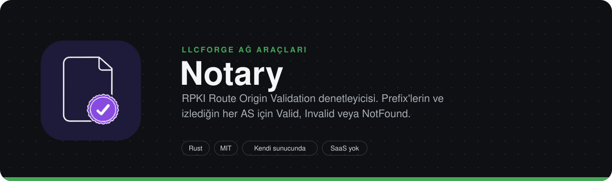
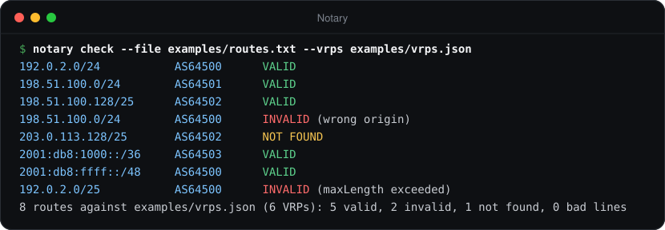
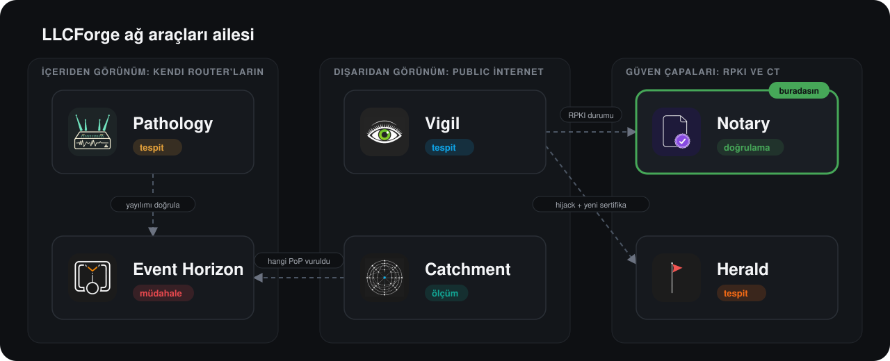

> **LLCForge ağ araçları** — kendi sunucunda, Rust, SaaS yok.
> [Pathology](https://github.com/LLCForge/Pathology) · [Event Horizon](https://github.com/LLCForge/Event-Horizon) · [Catchment](https://github.com/LLCForge/Catchment) · **Notary** · [Herald](https://github.com/LLCForge/Herald) · [Vigil](https://github.com/LLCForge/Vigil)

<!-- readme-visuals -->
<p align="center">
  
</p>

<p align="center">RPKI Route Origin Validation denetleyicisi. Prefix'lerinin RPKI-valid olup olmadığını söyler ve üçüncü taraf AS'leri izler.</p>

<p align="center">
  <a href="README.md">English</a> · <strong>Türkçe</strong>
</p>

<p align="center">
  <a href="LICENSE"></a>
  
  
</p>

---

## Neden

Giderek daha fazla ağ RPKI-invalid rotaları düşürüyor. Yanlış maxLength'li bir ROA ya da unutulmuş bir origin ASN, prefix'ini İnternet'in yarısından sessizce erişilemez hale getirir. Notary, doğrulanmış ROA payload'larının yerel ve sürekli güncel bir kopyasını tutar; hem kendi prefix'lerin hem de önemsediğin herhangi bir AS için "bu rota valid mi?" sorusunu müşterilerin fark etmeden yanıtlar.

## Örnek çıktı

<p align="center">
  
</p>

<sub>`notary check --file examples/routes.txt --vrps examples/vrps.json` komutunun, dokümantasyon adres aralıkları ve özel ASN'ler kullanan örnek veri üzerindeki gerçek çıktısı.</sub>

## Özellikler

- **VRP kaynakları:** kendi validator'ın (Routinator, rpki-client + StayRTR, FORT) için **düz TCP, TLS (rustls, isteğe bağlı karşılıklı TLS) veya SSH** (`rpki-rtr` alt sistemi, sabitlenmiş host anahtarı) üzerinden RTR istemcisi ya da dosyadan veya `http(s)://` URL'sinden JSON export'u (`{"roas":[...], "aspas":[...]}`).
- **RTR istemcisi:** sürüm 0 (RFC 6810), 1 (RFC 8210) ve 2 (draft-ietf-sidrops-8210bis, ASPA); cache desteklemezse otomatik olarak alt sürüme iner. Reset / Serial Query, artımlı güncellemeler, Serial Notify, Cache Reset, End of Data zamanlayıcıları, Error Report. Her PDU için katı uzunluk denetimi, 64 KiB PDU sınırı.
- **RFC 6811'e göre Route Origin Validation:** `Valid`, `Invalid` (`wrong_origin` / `max_length_exceeded`), `NotFound`; kapsayan her VRP listelenir ve açıklanır. AS0 ROA'ları hiçbir zaman eşleşmez.
- **ASPA ile AS_PATH doğrulama** (draft-ietf-sidrops-aspa-verification, upstream ve downstream); ASPA kayıtları RTR v2'den veya JSON `aspas` alanından gelir.
- **SLURM** (RFC 8416) yerel filtre ve eklemeleri; her güncellemede ve yapılandırma yeniden yüklenince yeniden uygulanır.
- **ROA süre sonu uyarıları:** izlenen her rota için rpki-client JSON `expires` veya Routinator `jsonext` `chainValidity` verisinden.
- **ROA önerici** (`notary suggest`): bir AS'in bugün anons ettikleri için en küçük ROA kümesi, maxLength = prefix uzunluğu.
- **maxLength denetimi** (`notary audit`, RFC 9319): AS'in anons etmediği prefix'lere de izin veren VRP'ler ve yerlerine konacak tam ROA'lar.
- **IRR tutarlılığı** (`notary irr`): RIPE DB REST API'sinden veya herhangi bir IRR whois sunucusundan alınan route/route6 nesneleri ile ROA'ların karşılaştırması.
- **Validator karşılaştırma** (`notary diff`): iki VRP kaynağı yan yana (JSON ile RTR, iki cache, ...).
- **Toplu denetim:** dosyadan veya stdin'den, metin ya da JSON Lines çıktısıyla.
- **VRP değişim geçmişi:** uygulanan her güncelleme bir öncekiyle karşılaştırılıp dönen (rotate edilen) bir JSON Lines dosyasına eklenir; prefix, ASN ve zamana göre sorgulanır (`notary history`, `GET /v1/history`).
- **`[[watch_as]]` için prefix kaynakları:** RIPEstat, Pathology `/v1/origins` üzerinden kendi router'larının görüşü ve bgp.tools tablo dökümü (birleşim; her kaynak için son geçerli liste korunur).
- **Daemon** (`notary run`): kalıcı izleme durumu (yeniden başlatmada tekrar alarm yok, kapalıyken olan değişim yakalanır); ortak [llcforge-beacon](crates/llcforge-beacon) dağıtıcısı üzerinden alarm (Telegram, HMAC imzalı webhook, Slack, Discord, Teams, e-posta, PagerDuty, Opsgenie, syslog, stdout), çökmeye dayanıklı kuyruk, susturma (silence), tekilleştirme; `/healthz` `/readyz`; SIGHUP, dosya değişimi veya `POST /v1/reload` ile yapılandırmayı yeniden yükleme; Windows hizmeti, systemd ve launchd.
- **HTTP API ve web arayüzü** `127.0.0.1:8323` üzerinde: tekli ve toplu validity, durum, geçmiş, ASPA, Prometheus `/metrics` ve gömülü prefix arama sayfası. İsteğe bağlı bearer token.

## Ailedeki yeri

Notary *"bu origin var olmalı mı?"* sorusunu kriptografik veriden yanıtlar. [Vigil](https://github.com/LLCForge/Vigil) ve [Pathology](https://github.com/LLCForge/Pathology) ise *"bu origin şu an var mı?"* sorusunu canlı yönlendirme verisinden yanıtlar. Her bulguyu RPKI durumuyla zenginleştirmek için Notary'nin `/v1/validity` uç noktasını çağırırlar; Notary de router'larının tam olarak neyi anons ettiğini izlemek için Pathology'nin `/v1/origins` uç noktasını çağırır.

<p align="center">
  
</p>

## Kurulum

Notary; Linux, macOS ve Windows (x86_64 ve aarch64) için tek bir statik ikili dosyadır. Sürüm arşivleri, paketler ve konteyner imajları `.github/workflows/release.yml` ile üretilir.

**Linux (deb / rpm + systemd)**

```bash
sudo apt install ./notary_<sürüm>_amd64.deb          # veya: sudo dnf install ./notary-<sürüm>.x86_64.rpm
sudoedit /etc/notary/notary.toml                     # [vrp] bölümünü kendi validator'ına yönlendir
echo 'NOTARY_TELEGRAM_TOKEN=...' | sudo tee /etc/notary/notary.env >/dev/null
sudo systemctl enable --now notary                   # unit: packaging/systemd/notary.service
sudo systemctl reload notary                         # SIGHUP: yapılandırmayı yeniden yükle
```

Unit `DynamicUser=yes`, `StateDirectory=notary` (`/var/lib/notary`) ve sıkı bir sandbox ile çalışır. `notary service install` aynı adımları yazdırır.

**macOS (Homebrew + launchd)**

```bash
brew install llcforge/tap/notary      # formül, sürümün package-manifests arşivinden
sudo install -m 0644 packaging/launchd/net.llcforge.notary.plist /Library/LaunchDaemons/
sudo launchctl bootstrap system /Library/LaunchDaemons/net.llcforge.notary.plist
```

**Windows (scoop / winget + hizmet)**

```powershell
# Hazır scoop / winget manifest'leri notary-<sürüm>-package-manifests.tar.gz içinde gelir
scoop install .\notary.json
# veya manifest winget-pkgs'e girdikten sonra: winget install LLCForge.Notary
# Yönetici PowerShell'de, sürüm zip'inin içinden:
.\install-service.ps1 -Config .\notary.example.toml -EnvFile .\notary.env
```

Hizmet `LocalService` hesabıyla, verisi `%ProgramData%\LLCForge\notary` altında olacak şekilde çalışır; ayrıntılar [packaging/windows/README.md](packaging/windows/README.md) dosyasında. `notary service install|uninstall|run` hizmeti doğrudan yönetir.

**Docker**

```bash
docker compose up -d     # docker-compose.yml: salt okunur kök dosya sistemi, yetki yok, /data volume
```

İmaj distroless'tır, root olmayan kullanıcıyla `notary run --config /etc/notary/notary.toml` çalıştırır. Konteyner içinde `[api] listen = "0.0.0.0:8323"` ayarla ve portu bilerek yayınla.

**Helm**

```bash
helm install notary deploy/helm/notary --set-file config=notary.toml
```

Probe'lar 8323 portundaki `/healthz` ve `/readyz` uç noktalarını kullanır; ServiceMonitor, Grafana panosu (`deploy/grafana/notary-dashboard.json`) ve Prometheus kuralları (`deploy/prometheus/notary-rules.yml`) dahildir.

**Kaynaktan**

```bash
git clone https://github.com/LLCForge/Notary.git && cd Notary
cargo build --release          # Rust 1.89+, C araç zinciri veya OpenSSL gerekmez
./target/release/notary check 198.51.100.0/24 AS64500 --vrps examples/vrps.json
```

## Kullanım

### Tek seferlik ve toplu denetim

```bash
notary check 198.51.100.0/24 AS64500 --vrps examples/vrps.json
notary check 192.0.2.0/24 64500 --rtr 192.0.2.10:3323
notary check 192.0.2.0/24 64500 --rtr tls://rpki.example.net --tls-ca-file ca.pem
notary check 192.0.2.0/24 64500 --rtr ssh://rtr@rpki.example.net \
    --ssh-key-file ~/.ssh/rtr_ed25519 --ssh-host-key SHA256:AbCd...
notary check 2001:db8:1000::/36 AS64503 --vrps examples/vrps.json --json
notary check --file examples/routes.txt --vrps examples/vrps.json --slurm examples/slurm.json
bgp-export | notary check --file - --rtr 192.0.2.10:3323 --json      # JSON Lines
```

Çıkış kodu: `0` Valid, `2` Invalid, `3` NotFound, `1` hata. Toplu modda: herhangi bir rota Invalid ise `2`, değilse herhangi biri NotFound ise `3`, okunamayan satır varsa `1`. Örnek:

```text
Route   198.51.100.0/24 origin AS64500
Source  examples/vrps.json (6 VRPs)
Result  INVALID (wrong origin)

Covering VRPs (2):
  198.51.100.0/24        max /24  AS64501      origin mismatch
  198.51.100.0/24        max /26  AS64502      origin mismatch

No covering VRP lists this origin AS. Networks that drop RPKI-invalid routes will reject it.
```

### ROA planlama ve denetimler

```bash
notary suggest AS64500 --vrps vrps.json                 # bugünkü anonslar için en küçük ROA kümesi
notary suggest AS64500 --prefixes-from http://127.0.0.1:8180   # router'larının görüşü (Pathology)
notary audit AS64500 --rtr 192.0.2.10:3323              # RFC 9319: gevşek maxLength
notary irr AS64500 --vrps vrps.json                     # RIPE DB route nesneleri ile ROA'lar
notary irr AS64500 --vrps vrps.json --irr whois://whois.radb.net
notary aspa "64511 64500" --vrps examples/vrps.json     # önce komşu, en sonda origin
notary aspa "64520 64510 64500" --direction downstream --rtr 192.0.2.10:3323 --rtr-version 2
notary diff vrps.json rtr://192.0.2.10:3323             # iki validator'ı karşılaştır
notary history --asn AS64500 --since 2026-01-01T00:00:00Z
```

`--prefixes-from` şunları alır: `ripestat` (varsayılan), `bgptools` (bgp.tools'un istediği gibi `--user-agent "<sen> - <iletişim>"` gerekir) veya bir Pathology temel URL'si (token `PATHOLOGY_API_TOKEN` ortam değişkeninden). `audit`, `irr` ve `diff` bir bulgu olduğunda `2` ile çıkar.

### Daemon

```bash
cp notary.example.toml notary.toml   # sonra düzenle
notary run --config notary.toml
notary --log-format json run --config notary.toml
notary silence add --resource "192.0.2.0/24*" --duration 2h -m "ROA geçişi"
```

Tüm anahtarlar [`notary.example.toml`](notary.example.toml) dosyasında açıklanmıştır. Önemli olanlar:

```toml
[vrp]
rtr = "tls://rpki.example.net"   # host:port, tls://host[:port], ssh://kullanıcı@host[:port]; ya da json = "..."
rtr_max_version = 2              # 2 = ASPA; gerekirse kendiliğinden alt sürüme iner
slurm = ["/etc/notary/slurm.json"]
expiry_warn_days = 7

[vrp.transport]
tls_ca_file = "/etc/notary/rtr-ca.pem"
# ssh_key_file / ssh_password_env / ssh_host_key = "SHA256:..."

[[watch]]
prefix = "198.51.100.0/24"
origin = 64500

[[watch_as]]
asn = 64501                      # bu AS'in anons ettiği her prefix

[prefix_sources]
ripestat = true
pathology_url = "http://127.0.0.1:8180"

[api]
listen = "127.0.0.1:8323"
token_env = "NOTARY_API_TOKEN"   # /v1/* için isteğe bağlı bearer token

[[alerts.sink]]
type = "telegram"
bot_token_env = "NOTARY_TELEGRAM_TOKEN"
chat_id = -1001234567890
```

Gizli bilgiler yapılandırmada yalnızca ortam değişkeni *adı* olarak geçer. 0.2 öncesi `[alerts] webhook_url_env / telegram_token_env / telegram_chat_id` anahtarları hâlâ çalışır ve sink'lere çevrilir (kullanımdan kalkma uyarısıyla); loopback dışındaki bir host'a düz `http://` webhook artık `allow_http = true` içeren açık bir `[[alerts.sink]] type = "webhook"` girdisi ister.

Alarmlar (`tool = "notary"`): `state_change` (kaynak `"<prefix> AS<origin>"`, rota Valid olunca çözüldü olarak işaretlenir), `roa_expiring`, `vrp_stale` (veri tazelenince çözülür), `vrp_empty_rejected`. İlk kez görülen izlenen bir rota yalnızca Invalid ise alarm üretir. İzleme durumu, VRP geçmişi, alarm kuyruğu ve susturmalar veri dizininde durur; bu yüzden yeniden başlatma alarmları tekrarlamaz ve Notary kapalıyken olan bir değişimi kaçırmaz.

Yeniden yükleme (`systemctl reload notary`, yapılandırma dosyasının değişmesi veya yönetici token'ıyla `POST /v1/reload`) alarm sink'lerini, SLURM'ü, izleme listesini ve prefix kaynaklarını yerinde uygular; VRP kaynağı ve API dinleyicisi için yeniden başlatma gerekir.

### HTTP API

```bash
curl 'http://127.0.0.1:8323/v1/validity?prefix=198.51.100.0/24&asn=AS64500'
curl -X POST http://127.0.0.1:8323/v1/validity -H 'Content-Type: application/json' \
     -d '{"routes":[{"prefix":"192.0.2.0/24","asn":64500},{"prefix":"198.51.100.0/24","asn":"AS64500"}]}'
```

```json
{"covering":[{"asn":64501,"max_length":24,"prefix":"198.51.100.0/24"},{"asn":64502,"max_length":26,"prefix":"198.51.100.0/24"}],"origin":64500,"prefix":"198.51.100.0/24","reason":"wrong_origin","stale":false,"state":"invalid"}
```

| Uç nokta | Döndürdüğü |
|---|---|
| `GET /v1/validity?prefix=..&asn=..` | `state` (`valid` / `invalid` / `not_found`), `reason`, `covering`, `stale`; hatalı girdide `400`, ilk VRP kümesinden önce `503` |
| `POST /v1/validity` | `{"routes":[{"prefix","asn"}]}` → istek sırasıyla `{"results":[...]}` (hatalı girdiler `error` taşır); en fazla `max_batch` (10000) rota, 4 MiB gövde |
| `GET /v1/status` | Kaynak, VRP / ASPA sayıları, RTR serial / session / sürüm, son güncelleme, `stale`, SLURM, son hata |
| `GET /v1/history?prefix=&asn=&since=&limit=` | VRP değişim olayları, en yeniden eskiye |
| `GET /v1/aspa?path=64511+64500&direction=upstream` | Adım adım sonuçlarla ASPA doğrulaması |
| `GET /healthz`, `GET /readyz` | Canlılık; hazır olma = VRP verisi yüklü ve taze |
| `GET /metrics` | `notary_*` ve `llcforge_beacon_*` Prometheus metrikleri |
| `GET /` | Web arayüzü: prefix arama, kapsayan VRP'ler, VRP geçmişi |
| `/v1/silences`, `POST /v1/reload` | Yalnızca yönetici token'ları ayarlıysa açılır |

`[api] token_env` ayarlıysa her `/v1/*` isteği `Authorization: Bearer <token>` ister; web arayüzündeki token alanı token'ı yalnızca sayfa belleğinde tutar.

## Performans

`notary bench` ile ölçülmüştür (release derlemesi, varsayılanlar: 600.000 IPv4 + 200.000 IPv6 sentetik VRP, 2.000.000 rota, tek iş parçacığı); Intel Core Ultra 7 255HX, 32 GB RAM, Windows 11 dizüstü. Aynı makinede başka derlemeler sürerken art arda iki çalıştırma:

| Adım | 1. çalıştırma | 2. çalıştırma |
|---|---|---|
| Trie dizinini kurma (800.000 VRP) | 466 ms | 422 ms |
| Bir rotayı doğrulama (RFC 6811, kapsayan VRP'ler toplanıp sıralanarak) | 1.076.415 rota/sn (929 ns) | 565.744 rota/sn (1.768 ns) |
| JSON export ayrıştırma (55,6 MiB) | 114,4 MiB/sn | 90,4 MiB/sn |
| RTR prefix PDU çözme | 43,0 M PDU/sn | 35,3 M PDU/sn |

Kendi donanımını ölçmek için `notary bench` (veya `notary bench --vrps <export'un>`) çalıştır; ikinci çalıştırma, meşgul bir makinenin ne kadar fark yarattığını gösterir.

## Platform notları

Her şey saf Rust'tır (rustls / ring, russh); hiçbir işletim sisteminde OpenSSL veya C araç zinciri gerekmez. Notary hiçbir yerde özel yetki istemez: dışarıya TCP bağlantıları açar ve tek bir dinleme soketi kullanır. SSH anahtarları Ed25519 veya ECDSA olmalıdır: `rsa` crate'inde düzeltilmemiş bir zamanlama açığı (RUSTSEC-2023-0071) bulunduğu için RSA desteği derlemeye alınmamıştır. Windows'ta SIGHUP olmadığından yeniden yükleme dosya değişimiyle veya `POST /v1/reload` ile yapılır.

## Yol haritası

- RTR v2 üzerinden ASPA, draft-ietf-sidrops-8210bis'e göre uygulanmış ve süreç içi bir cache'e karşı test edilmiştir; sürüm 2 konuşan gerçek bir üretim cache'ine karşı henüz denenmedi.
- bgp.tools kaynağı belgelenmiş `table.jsonl` biçimine (CIDR / ASN / Hits) göre yazılıp örnek verilerle test edildi; bgp.tools User-Agent içinde kişisel iletişim bilgisi istediği için CI'da canlı olarak çalıştırılmadı.
- VRP geçmişi yalnızca daemon çalışırken değişimleri tek tek kaydeder; açılıştan sonraki ilk küme `baseline` sayısı olarak yazılır. Kapalıyken olan değişimler izleme alarmlarında görünür, ancak geçmişte tek tek listelenmez.
- `notary aspa` verilen AS_PATH'i doğrular; taslaktaki komşu-AS ve AS_SET ön denetimleri router'ın işidir ve yalnızca verdiğin yola uygulanır.
- API'de bağlantı başına başlık (header) zaman aşımı yok; dışarı açacaksan loopback'te veya bir reverse proxy arkasında tut.

## Nasıl çalışır

Bileşenler, veri akışı, güven sınırları ve hata senaryoları için [ARCHITECTURE.md](ARCHITECTURE.md) dosyasına bak.

## İlgili araçlar

- [Vigil](https://github.com/LLCForge/Vigil): Public RIPE RIS ve RouteViews feed'leri üzerinden gerçek zamanlı origin hijack tespiti. Başka biri prefix'ini anons ettiği an işaretler.
- [Pathology](https://github.com/LLCForge/Pathology): Kendi router'ların ve BMP beslemelerin için BGP rota izleyici. Prefix'lerinin normalde kullandığı AS path'leri ve origin'leri öğrenir, en küçük sapmada alarm verir.
- [Herald](https://github.com/LLCForge/Herald): Certificate Transparency log izleyici. Domain'lerin için yeni bir TLS sertifikası çıkarıldığı an Telegram'dan alarm gönderir.

## Katkı

Issue ve pull request'ler memnuniyetle karşılanır. Önce [CONTRIBUTING.md](CONTRIBUTING.md) ve [Davranış Kuralları](CODE_OF_CONDUCT.md) dosyalarını oku. Bir güvenlik açığı mı buldun? Public issue **açma**; [SECURITY.md](SECURITY.md) adımlarını izle.

## Lisans

Notary, [MIT Lisansı](LICENSE) ile yayınlanan özgür ve açık kaynak bir yazılımdır. Atıflar için [NOTICE](NOTICE) dosyasına bak.
